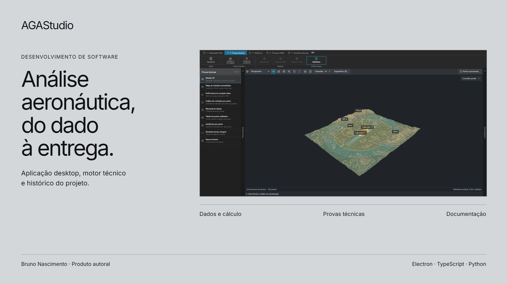

# AGAStudio

Software desktop para análise aeronáutica e produção técnica.



O programa reúne dados geoespaciais, cálculos, provas, relatórios, desenhos e assistência por IA em um projeto com histórico e referências de origem.

**Bruno Nascimento:** concepção do produto, fluxos e direção visual; construção com desenvolvimento assistido por IA, definição e revisão das funcionalidades.

## Conhecer o programa

| Área | Papel |
|---|---|
| Dados e referências | Geometria, coordenadas, cotas, arquivos e pesquisa. |
| Análise OPEA | Preparação, motor e leitura dos limites e das margens. |
| Helipontos/PBZPH | Ficha, condições, alternativas e superfícies próprias. |
| Provas técnicas | Mapas, tabelas, perfis e visualização da rodada. |
| Relatórios e documentos | Fontes, resultados, narrativas e revisão documental. |
| Desenhos e processo | Composição técnica, checklist e preparação assistida. |
| Assistentes | Contexto, adaptadores, ferramentas e confirmações. |
| Projeto .aga | Integridade, versões, histórico, backups e recuperação. |

A [apresentação do produto](docs/product.md) e o [guia dos 13 capítulos](docs/modules/README.md) explicam o conjunto. A [arquitetura](docs/architecture.md) relaciona interface, motor, arquivos e serviços.

## Executar os exemplos

Requisitos: **Node.js 24.12 ou superior** e **Python 3.10 ou superior**. Os módulos e a biblioteca de compressão estão incluídos; estes comandos não exigem instalação de dependências.

```sh
npm test
python tests/test_height_policy.py
npm run demo
```

No Windows, `py` pode substituir `python` conforme a instalação. Os testes de arquivo criam pequenas pastas temporárias com prefixo `agastudio-engineering-`; nunca abrem projetos do usuário. Eles conservam esses arquivos para inspeção. O exemplo trabalha em memória e demonstra o contêiner do formato, sem executar o motor.

## Examinar as decisões

- [Integridade do .aga](docs/decisions/integridade.md).
- [Histórico e atualização das entregas](docs/decisions/historico.md).
- [Cálculo, política e apresentação dos números](docs/decisions/numeros.md).
- [Ferramentas e confirmações do assistente](docs/decisions/ferramentas.md).
- [Geometria, visualização e resultado](docs/decisions/geometria.md).

## Código e procedência

São **seis módulos executáveis selecionados**: leitor do .aga, marcadores de conteúdo, armazenamento, política de arquivos, executor controlado de arquivos e política numérica. [sources.json](sources.json) registra os caminhos de origem, hashes e adaptações. A única adaptação dos módulos é o caminho de importação da biblioteca de compressão.

Os **cinco arquivos em reference** conservam trechos completos do modelo, contrato do relatório, visualizador, superfícies e motor de heliponto. Dependem do restante da aplicação, seus tipos e bibliotecas; não são executados por esta suíte.

O programa completo não é distribuído neste pacote. A biblioteca fflate 0.8.2 consta em vendor com sua licença MIT e identificação em [THIRD_PARTY.md](THIRD_PARTY.md). Ela não constitui implementação própria do AGAStudio.

## Verificações desta edição

Os **30 testes passaram em 04/11/2026**, com Node.js 24.14.0 e Python 3.12. Os [registros de execução](evidence/verification.json) identificam comandos e alcance.

| Grupo | Cenários | Alcance |
|---|---:|---|
| Formato e marcadores de mudança | 12 | Abertura, anexos, integridade, versão e comparação de conteúdo. |
| Arquivos e recuperação | 10 | Backup, recuperação, leitura e confirmação em pastas fictícias. |
| Política numérica | 8 | Reserva própria EasyAGA e exibição dos limites. |

Os comandos verificam comportamento; não fazem verificação estática de tipos. Não executam o motor normativo completo, conversas com fornecedores de IA, processos administrativos reais ou uma certificação de release.

## Interfaces e limites

As imagens combinam o estudo salvo da apresentação de UX/UI e uma fixture fictícia de heliponto, identificados nas legendas. Os cenários são distintos. O exemplo de heliponto conserva pendências; o mapa salvo não equivale a um projeto aprovado. A prévia CAD gerada nesse cenário apresentou limitação na base cartográfica e ficou fora da seleção de prova de entrega final.

A interface, a presença de testes e o código de referência não representam aprovação global do produto. Não há resultado comercial ou medição de ganho de tempo nesta edição.

[Portfólio de Bruno Nascimento](https://bruniversamente.github.io/) · [Rakestra App](https://github.com/bruniversamente/rakestra-app-engineering) · [Rakestra Gestão](https://github.com/bruniversamente/rakestra-gestao-engineering)
