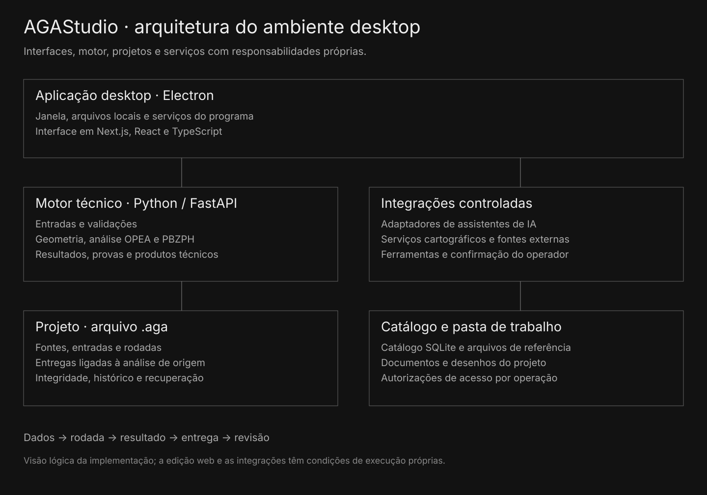

# Arquitetura do AGAStudio

Electron integra janela, serviços e arquivos locais. A interface usa Next.js, React e TypeScript; o motor técnico usa Python/FastAPI. O catálogo SQLite e os arquivos de referência participam da pesquisa, enquanto o .aga conserva a versão do estudo e seus produtos derivados. Os adaptadores de IA e as bases cartográficas podem depender de serviços externos e configuração.

O diagrama descreve responsabilidades lógicas, não a topologia de produção. A edição web tem capacidades e condições próprias; não há promessa de funcionamento integral sem internet.
