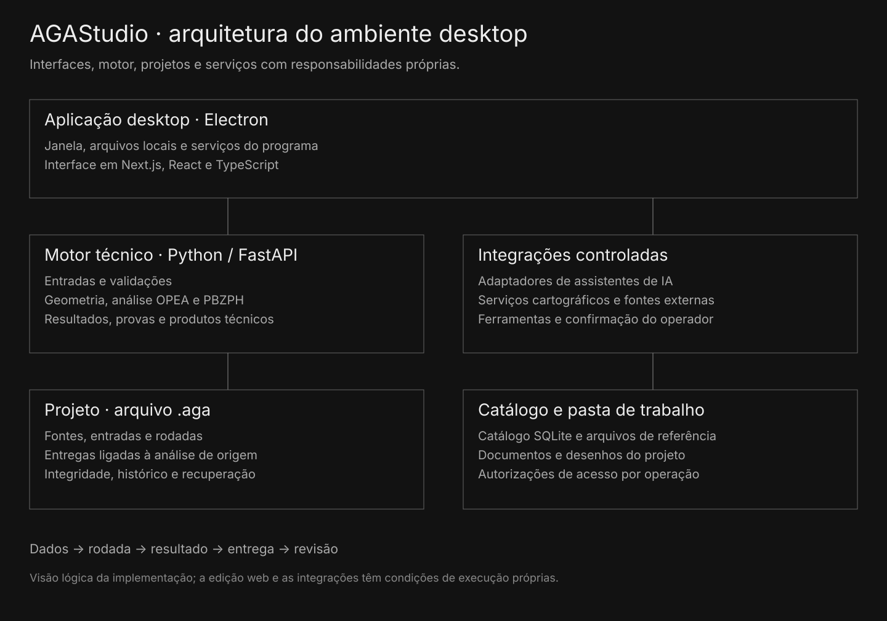

# Conectar interface, motor, arquivos e serviços

A aplicação desktop usa Electron para integrar janela, arquivos e serviços locais. A interface utiliza Next.js, React e TypeScript. O motor técnico Python/FastAPI processa os contratos e as funções de análise.

O catálogo SQLite e seus arquivos fornecem referências para o trabalho. O projeto .aga conserva a versão do estudo e os vínculos entre os produtos derivados. Mapas e assistentes podem depender de serviços externos e das configurações de acesso aplicáveis.

Diagrama lógico das responsabilidades do programa desktop.

| Parte | Responsabilidade |
| --- | --- |
| Interface | Preparação, navegação, consulta e revisão. |
| Motor técnico | Validações, geometria, cálculo e produtos técnicos. |
| Modelo do projeto | Fontes, versões, resultados e relações entre entregas. |
| Integração desktop | Arquivos, recuperação e execução dos serviços. |
| Adaptadores | Comunicação com serviços externos e eventos da tarefa. |

Os arquivos de referência no GitHub permitem consultar as relações do modelo, o contrato do relatório e partes dos motores e da visualização. Dependem do restante do produto; os testes públicos executam somente os módulos selecionados.
