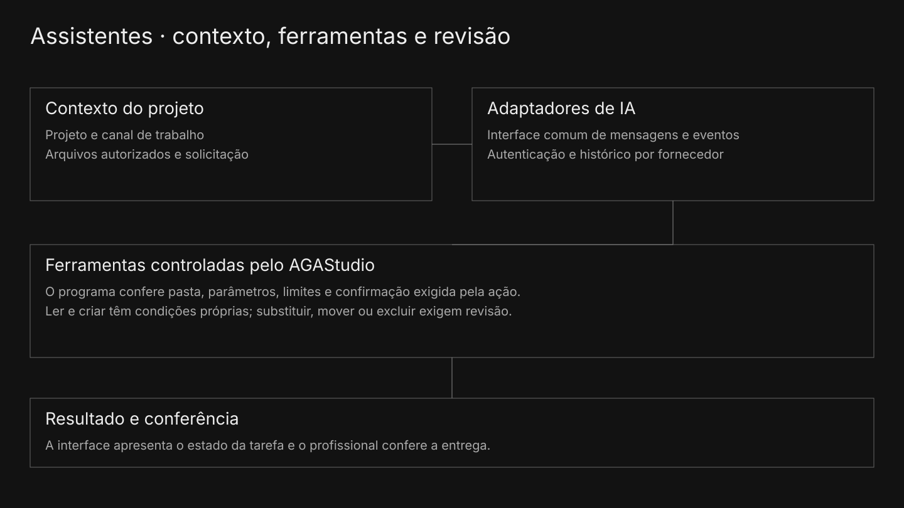

# Dar contexto à IA e conferir a ação solicitada

O AGAStudio integra assistentes aos canais de trabalho do projeto. A interface comum organiza mensagens e eventos, enquanto os adaptadores tratam a comunicação com os fornecedores presentes na versão.

As ferramentas do aplicativo conferem a pasta autorizada, os caminhos, os parâmetros e as condições da operação. A camada de arquivos recusa saídas da raiz e nomes protegidos; alterações que exigem confirmação permanecem pendentes até a decisão do operador.

Diagrama da integração · os adaptadores propõem ações às ferramentas controladas pelo programa.

| Situação verificada | Resultado no módulo selecionado |
| --- | --- |
| Ler um texto da pasta do exemplo | Retorna o trecho solicitado. |
| Usar um caminho com saída da pasta | Recusa a operação. |
| Ler um nome de arquivo protegido | Recusa a leitura. |
| Substituir conteúdo existente sem aprovação | Pede confirmação e preserva os bytes originais. |

Esses cenários passaram em arquivos fictícios temporários, usando o código de arquivos do produto. Eles não executam uma conversa com um fornecedor de IA nem certificam toda a integração. O uso de IA na construção do programa e sua integração como funcionalidade têm papéis distintos nesta apresentação.
