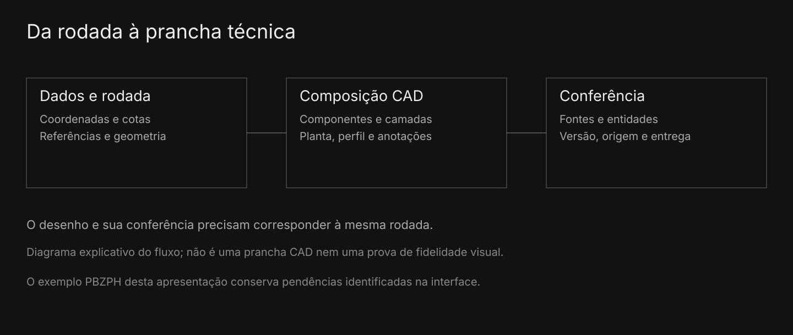

# Relacionar geometria, composição e conferência da prancha

A preparação de desenhos conecta os dados técnicos aos componentes, camadas e informações da prancha. O editor oferece navegação do Paper Space e caminhos de exportação dos arquivos disponíveis.

A qualidade de uma entrega CAD exige conferir o arquivo e sua renderização, incluindo fontes, entidades e referências. Um desenho gerado ou uma prévia na tela ainda pode exigir correções antes da entrega.

Fluxo explicativo · a entrega CAD exige conferir o arquivo e a renderização da versão avaliada.

Nesta edição, o cenário PBZPH permitiu gerar uma prévia no editor. A composição carregou uma base cartográfica com aviso de credencial; por isso, essa imagem não entra como prova de prancha final. O diagrama apresenta o fluxo de implementação e a conferência que permanece necessária.
