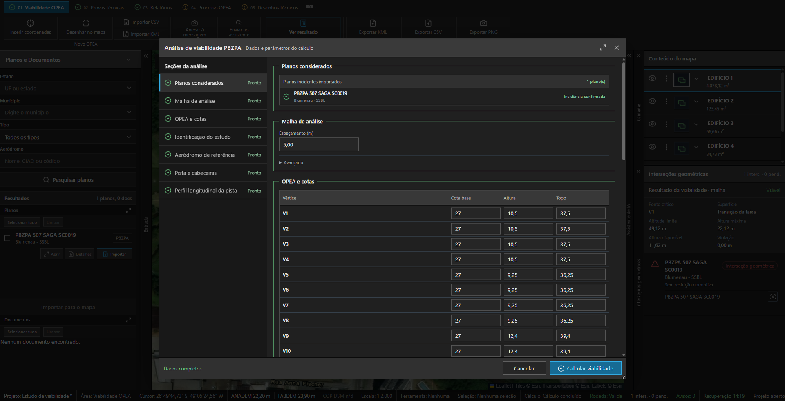

# Conferir o que entra antes de interpretar o resultado

O especialista pode informar pontos e geometrias e trabalhar com arquivos de origem. A preparação reúne referências de coordenadas e altitude, cotas, dados da pista e planos associados ao empreendimento.

O modelo distingue o plano encontrado na pesquisa, sua interseção geométrica e a restrição avaliada no cálculo. Encontrar uma geometria sobre a área é uma etapa da análise, com estado e origem próprios.

Antes do cálculo · dados técnicos, referências e conferências no mesmo fluxo.

| Informação | Responsabilidade |
| --- | --- |
| Geometria e identificação | Manter a relação entre o arquivo de origem, o objeto e seus pontos. |
| Referências e unidades | Distinguir coordenadas horizontais, altitude, altura e cota de base. |
| Planos e documentos | Registrar a fonte e o papel da referência na análise. |
| Dados ausentes | Apresentar a pendência sem transformar ausência em valor zero. |
