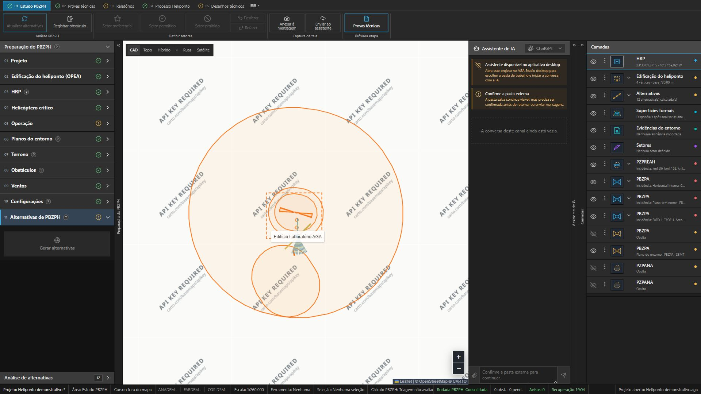
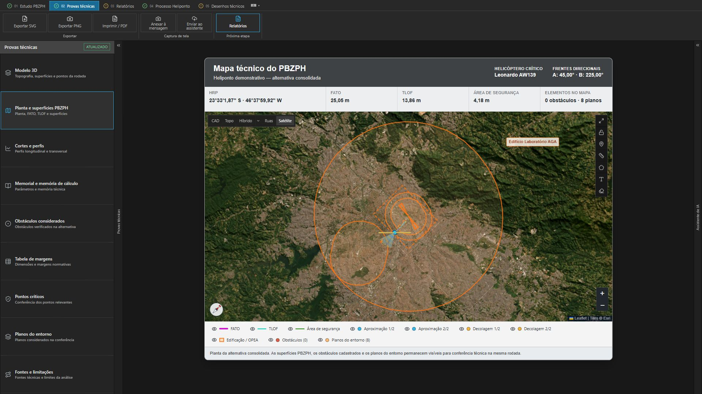

# Um modo de projeto com preparação e verificações próprias

O modo de heliponto reúne ficha, posição de referência, aeronave crítica, condições de operação e dados do entorno. O profissional percorre a preparação, compara alternativas e consulta as superfícies e provas ligadas ao cenário selecionado.

A captura usa o projeto fictício de teste do produto. Seu mapa mostra uma alternativa salva; a preparação ainda contém pendências e a triagem não constitui um projeto aprovado. Essa condição permanece identificada durante a leitura do exemplo.

Heliponto fictício · etapas, dados e alternativas com pendências identificadas.

Mapa técnico do exemplo salvo · superfícies e entorno; não equivale à aprovação do projeto.

O motor e os contratos de PBZPH têm validações específicas de geometria, parâmetros e referências. O repositório público inclui arquivos de referência para consulta; esta edição não executa sua suíte normativa completa.
