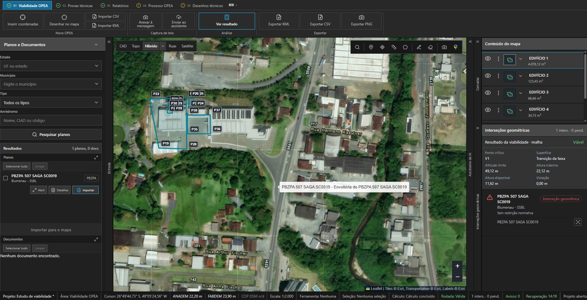
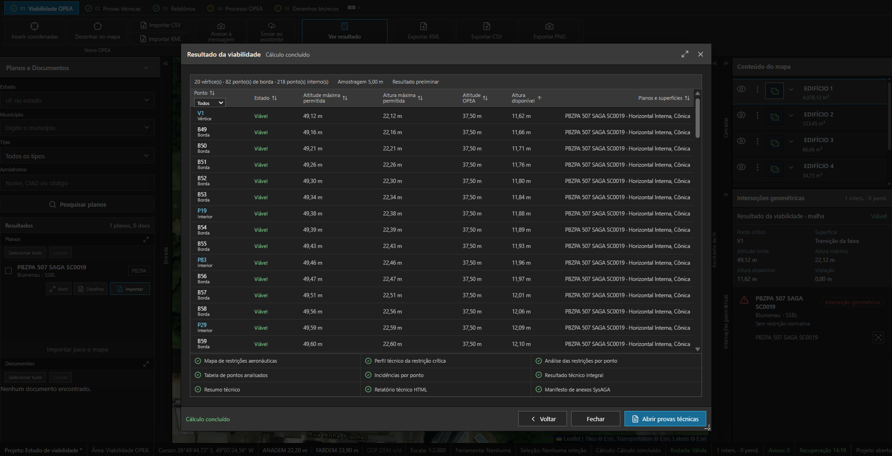

# Da solicitação ao resultado de cada ponto

A interface organiza a solicitação; o motor Python aplica os parâmetros e as funções geométricas da análise. O retorno conserva resultados por ponto e informações para localizar a superfície determinante, a altitude limite, a altura máxima e a margem.

Os pontos amostrais da viabilidade e os vértices oficiais do percurso formal cumprem papéis distintos. Os relatórios e pacotes precisam conservar essa distinção ao apresentar e reutilizar os resultados.

Viabilidade · empreendimento, camadas e resultado na mesma área de trabalho. Base cartográfica Esri.

Resultado da rodada · vértices, pontos de borda e amostras internas com papéis próprios.

O código também separa o limite calculado, a política própria de reserva da EasyAGA e a exibição dos valores. O pacote de apoio testa a aplicação de 0,10 m uma única vez e a formatação conservadora. Essa política não é apresentada como exigência do órgão regulador; os oito testes numéricos não validam o motor normativo completo.

| Camada | O que precisa permanecer coerente |
| --- | --- |
| Entrada | Geometria, cotas, parâmetros e referências. |
| Rodada | Identidade dos dados usados e versão da análise. |
| Resultado | Limites, margens e estados produzidos pelo motor. |
| Apresentação | Valores da rodada e critérios de formatação. |
