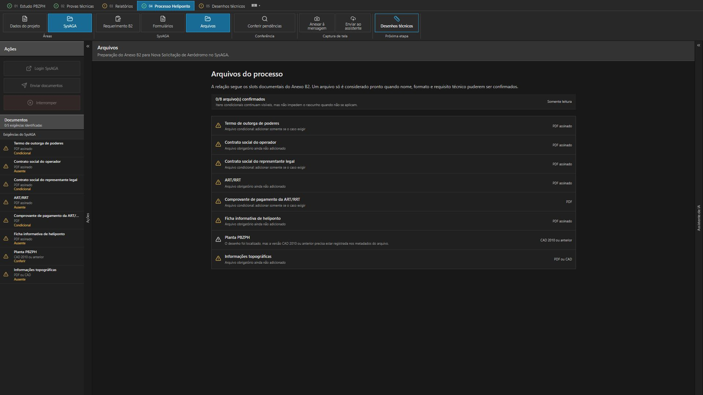

# Conferir os documentos antes de preparar a operação

O programa reúne dados, documentos, checklist e pacotes no contexto do projeto. Arquivos ausentes, condições de formato e referências de origem continuam visíveis para revisão do profissional.

O percurso assistido relaciona pacote, projeto e rodada e conserva estados de validação e simulação. A execução e a revisão do operador têm responsabilidades próprias; a presença de um botão ou de um pacote não comprova envio de um processo.

Exemplo fictício · arquivos ausentes e condições para a revisão do pacote.

No exemplo fictício, o checklist conserva os documentos ausentes e a condição de conferência do desenho. A preparação desta apresentação não acessa ou movimenta processos reais.
