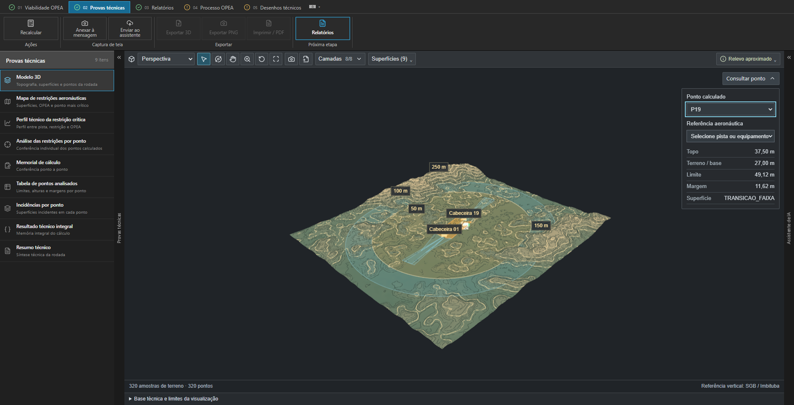
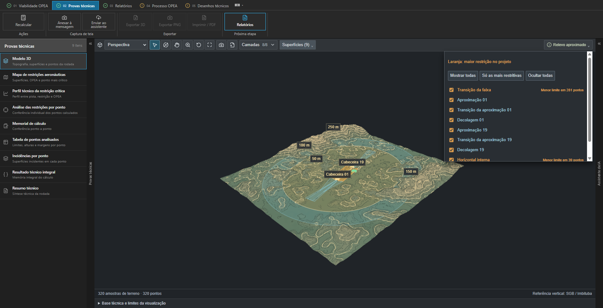
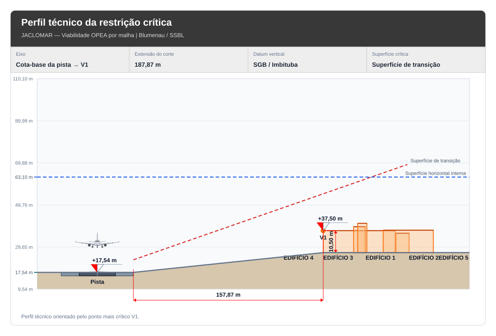

# Ler os mesmos valores em representações diferentes

Nas provas técnicas, o especialista consulta mapa, perfil, tabelas e modelo 3D da rodada escolhida. A seleção do ponto conserva a relação entre sua identificação e os valores calculados.

A navegação, a câmera e a visibilidade das camadas alteram a leitura espacial. O cálculo continua associado à rodada. O relevo de contexto permanece identificado como aproximado quando tem apenas função visual.

Consulta no modelo · o ponto conserva sua identificação de origem e os valores da rodada.

Controle de visibilidade · todas as superfícies, somente as mais restritivas ou seleção individual.

Detalhe vetorial · perfil original do estudo salvo, preservado sem redesenhar os valores.

A vista 3D navegável pertence às provas técnicas. O profissional pode escolher uma imagem para inserir em um relatório; essa inclusão é explícita e conserva referências da vista e da rodada. O perfil vetorial acima pertence ao estudo salvo usado no case de UX/UI e mantém sua composição original.
