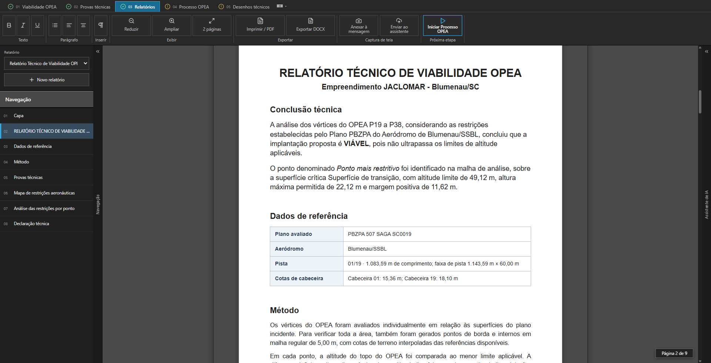

# Manter a relação entre uma afirmação e sua fonte

O relatório reúne identificação, fontes, premissas, método, resultados e provas. O profissional pode revisar os textos narrativos previstos no contrato; os valores técnicos permanecem ligados ao resultado que originou o documento.

A leitura documental usa evidências de extração com origem, campo, valor e estado de revisão. Um valor extraído precisa passar pelas etapas de conferência e confirmação antes de alimentar os dados técnicos do projeto.

Relatório · síntese, fontes e resultados para revisão e comunicação ao cliente.

| Conteúdo | Tratamento no produto |
| --- | --- |
| Valores da análise | Derivados da rodada e conferidos pelo contrato do relatório. |
| Narrativas editáveis | Objetivo, premissas, metodologia e ressalvas nos campos previstos. |
| Extração de documentos | Evidências com transições de extração, revisão e confirmação. |
| Mudança nos dados | Revisão das entregas ligadas à versão anterior. |
