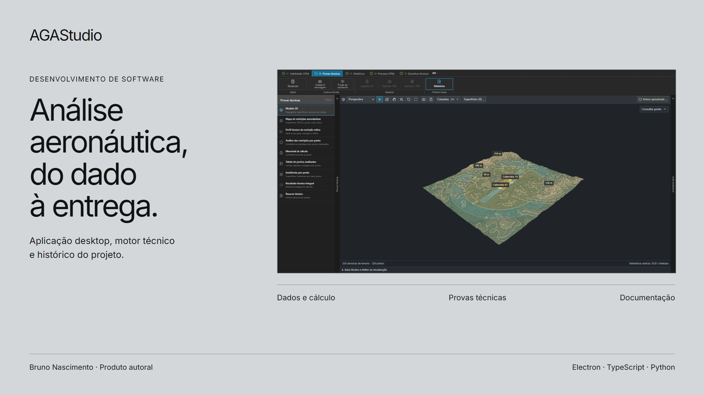

# AGAStudio

Software desktop para análise aeronáutica e produção técnica.

Construção de um ambiente que conecta dados geoespaciais, cálculo, provas e documentação em um projeto com histórico e referências de origem.

## Percurso de leitura

- [O programa](modules/produto.md): Um ambiente para conduzir o trabalho técnico.
- [Origem e participação](modules/participacao.md): Do trabalho na consultoria à construção do programa.
- [Dados e referências](modules/dados.md): Conferir o que entra antes de interpretar o resultado.
- [Motor e análise OPEA](modules/opea.md): Da solicitação ao resultado de cada ponto.
- [Helipontos e PBZPH](modules/helipontos.md): Um modo de projeto com preparação e verificações próprias.
- [Provas e modelo 3D](modules/provas.md): Ler os mesmos valores em representações diferentes.
- [Relatórios e documentos](modules/relatorios.md): Manter a relação entre uma afirmação e sua fonte.
- [Desenhos técnicos](modules/cad.md): Relacionar geometria, composição e conferência da prancha.
- [Preparação do processo](modules/processo.md): Conferir os documentos antes de preparar a operação.
- [Assistentes e ferramentas](modules/assistentes.md): Dar contexto à IA e conferir a ação solicitada.
- [Arquivo .aga e histórico](modules/projeto.md): Guardar a origem e reconhecer o que mudou.
- [Arquitetura](modules/arquitetura.md): Conectar interface, motor, arquivos e serviços.
- [Qualidade e código](modules/qualidade.md): Evidências que o leitor pode conferir.

A apresentação cobre o produto inteiro; o código executável neste pacote corresponde aos módulos selecionados no manifesto. Os estados incompletos do exemplo e os limites das verificações permanecem identificados nos capítulos.
